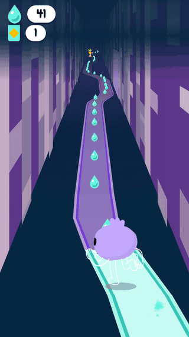
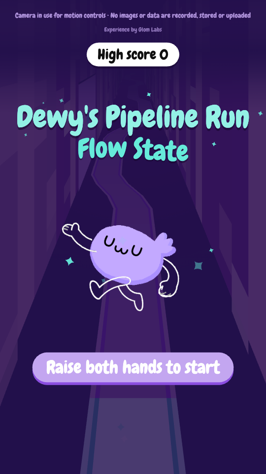
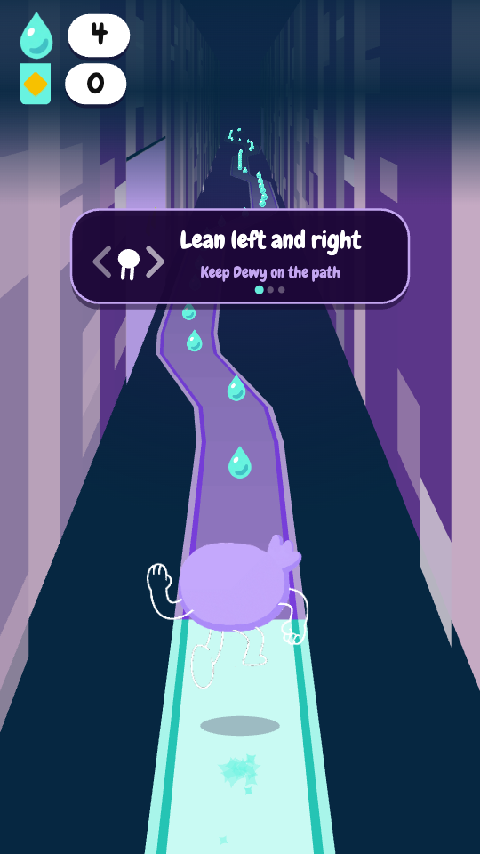
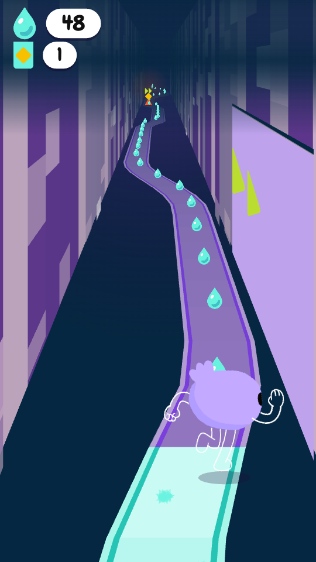
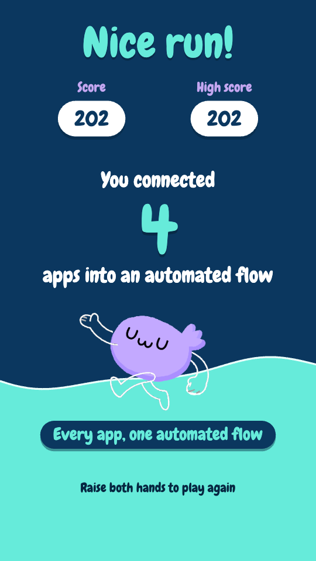

# Pose Runner: Dewy's Pipeline Run

An endless runner you play with your body. Lean to steer Dewy down a winding path, raise a hand to jump, and watch the path turn from purple to turquoise behind you. Everything runs in the browser: pose tracking, rendering and a synthesized soundtrack, with no server and no network calls.

**Play it:** [cheegrace.github.io/pose-runner](https://cheegrace.github.io/pose-runner/) (Chrome, webcam on, stand back so your shoulders are in frame; arrow keys and space work too)

<p align="center"></p>

I built it solo for a brand activation beside Moscone Center during Dreamforce 2026: concept, art direction, game and copy. This repo is the game, ready to play at home.

| Title | How to play | The run | Score card |
|---|---|---|---|
|  |  |  |  |

## How it plays

| | |
|---|---|
| **Stay on the ribbon** | The path steps between three lanes with rounded corners. Step off and you teeter for half a second before you fall, so a late corner is recoverable. |
| **Follow the dewdrops** | They're laid along the path, so chasing them steers you correctly without being told to. |
| **Pass a doorway** | The app connects: the panel floods turquoise and pays out 25 dewdrops. |
| **Jump or dodge the grumpy clouds** | One touch ends the run. A raised hand clears them as well as steering around does. |
| **Run through a totem** | Four seconds of hands-free Flow State: Dewy runs the path with both arms up, collecting everything, and nothing can touch her. |

Every run opens with three how-to-play cards. Each names one control and waits until you actually do it, with a time cap so nobody gets stuck.

### Controls

| Body | Keyboard | Action |
|---|---|---|
| Raise both hands | any letter key | Start a run |
| Lean left / right | `←` `→` (or `A` `D`) | Steer, proportionally |
| Raise either hand | `Space` `↑` `W` | Jump |
| | `Esc` | Skip the how-to-play cards |
| | `M` / `C` / `P` | Mute / recalibrate your neutral pose / retry the camera |

## How it's built

Plain JavaScript and Canvas 2D, no framework and no build step.

- **Pose input.** [MediaPipe Pose Landmarker](https://ai.google.dev/edge/mediapipe/solutions/vision/pose_landmarker) (lite) runs locally in the browser. Lean and jump thresholds are measured in **shoulder widths**, so the game feels the same whether you stand close to the camera or far away, with a dead zone so standing still is genuinely still. Keyboard input is always live alongside it, and if the camera fails the game keeps running on keys.
- **Fake 3D.** Every object has a depth. One projection function maps depth and lateral offset to screen position and scale, and it's solved from three framing rules at every resize, so the game reframes for any aspect ratio, from landscape to a tall portrait column of stacked monitors.
- **The transformation.** The corridor, path, doorways and shapes are drawn as vectors, not PNGs, because the purple to turquoise change has to recolor geometry on the fly. Only Dewy is hand-drawn art: six back-view rigs composited live, so the boost pose can raise both arms and her body turns into a hard lean.
- **Audio.** Every sound is synthesized with Web Audio: a four-bar loop in F# minor pentatonic plus a dozen effects, a few kB of oscillator code instead of audio files. A totem opens the filter, lifts the arpeggio an octave and speeds the loop up, so the music reacts instead of crossfading.
- **Fully offline.** The stand's wifi couldn't be trusted, so MediaPipe, the model and the font are all bundled. Nothing is fetched from a CDN, and the game loads and plays with wifi off.
- **Hardware hook.** `js/mist.js` exposes `fireMist()` for a physical mist dispenser. It fires on every totem and at the end of a run, with a cooldown so a hot streak can't empty the canister. Here it's a stub that logs and flashes the screen.

### Fairness, tested

`test/smoke.js` is a headless harness that runs real game frames against a stubbed canvas. It plays the game with a deliberately imperfect player (reaction lag, wobbly aim, lapses of attention) and asserts three rules:

- **Every corner is one Dewy can physically make,** even at top speed for a player who only reacts and never anticipates.
- **Ignoring a corner costs you.** Lanes are wider than the path plus its grace margin, so standing still through a turn puts you over the void.
- **The game never asks for two things at once.** Clouds only sit on straight stretches, never mid-turn, and never on a totem.

It also renders every screen at four aspect ratios and checks the state machine, scoring, the boost, the audio and mist fallbacks, and the pose logic driven by synthetic landmarks.

```sh
node test/smoke.js
```

## Run it locally

Browsers block webcams on `file://`, so serve it over localhost:

```sh
python3 -m http.server 8000    # then open http://localhost:8000 in Chrome
```

On a Mac, `start.command` is the one-click kiosk launcher used at the stand. It serves the game, keeps the display awake and opens Chrome in its own profile (`KIOSK=1 ./start.command` for fullscreen).

Everything worth tuning is a named constant in `js/config.js`: lean range and dead zone, jump height, speed curve, corner sharpness, grace time, cloud frequency, totem timing, and the operator overlays (`SHOW_POSE_DEBUG`, `SHOW_FPS`).

## Files

```
index.html        script tags, in load order
js/config.js      every tunable constant
js/assets.js      the PNG manifest and a loader that never blocks
js/shapes.js      the geometric shapes, plus shared path helpers
js/view.js        canvas sizing and the solved fake-3D projection
js/track.js       the winding centreline and the doorways on it
js/corridor.js    walls, path ribbon, doorways, purple to turquoise
js/entities.js    Dewy, dewdrops, clouds, totems, sparkles
js/spawner.js     lays the run down ahead of the player
js/audio.js       the whole soundtrack, synthesized
js/pose.js        keyboard and MediaPipe pose input
js/ui.js          HUD, title card, how-to-play, the wave, the score card
js/mist.js        fireMist() and the hardware stub
js/main.js        game loop and state machine
js/lib/, models/  bundled MediaPipe and pose model
assets/           Dewy's rigs and the Chewy font
test/smoke.js     headless test harness
```

## License

Code: MIT. The character art in `assets/` is not licensed for reuse. Third-party components are listed in [THIRD_PARTY.md](THIRD_PARTY.md).

Made by [Grace Chee](https://www.gracechee.com) at Glom Labs.
